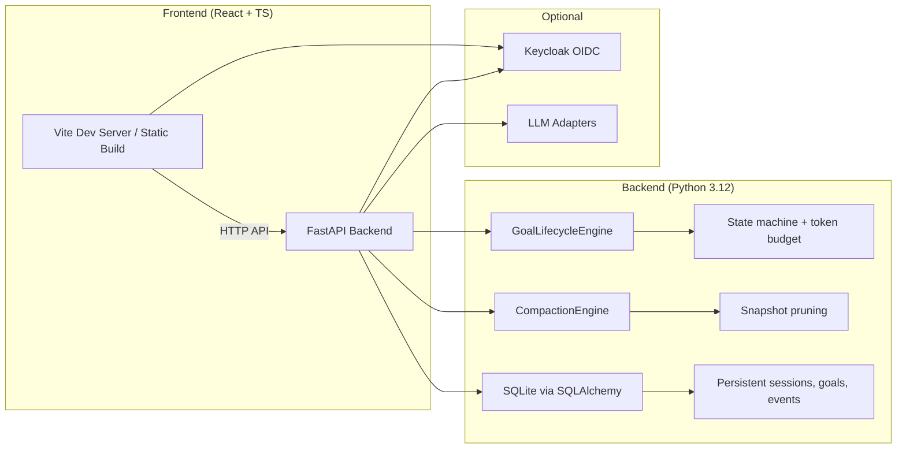

# Beacon Forge — Alan Vo | AI & Machine Learning

> Work in progress. This checkpoint may be incomplete or fail tests. See PLAN.md and STATUS.md before use.


Beacon Forge is an AI/ML developer tool that addresses the growing problem of
unbounded event-log growth in agent session stores (opencode issue #33356). It
provides a server API and web dashboard for managing coding-agent sessions with
per-goal token budgets, deterministic lifecycle state machines, and an
event-sourced activity timeline that automatically compacts superseded snapshot
events — preventing the 13 GB+ database bloat reported by long-running agent
instances.

Intended for AI/ML researchers and developers who need accountable, auditable
agent sessions with token consumption tracking and bounded storage.

---

## Features

- **Session management**: Create sessions representing AI coding-agent runs.
  Sessions are grouped with goals and archived via soft-delete.
- **Goal lifecycle domain engine**: Per-session goals with an optional token
  budget. A deterministic state machine enforces valid transitions:
  `pending → running → completed | failed | paused`, with `failed → running`
  retry support. Completion is rejected when consumed tokens exceed budget +
  tolerance.
- **Event-sourced activity timeline**: Each goal has an immutable append-only
  event log. Snapshot events are compacted — only the latest snapshot per goal
  is retained; older ones are pruned on read. This directly addresses the
  unbounded `message.updated.1` growth pattern.
- **Token budget enforcement**: Goals with a token budget reject completion when
  consumed tokens exceed `budget × (1 + tolerance)` (default 5% tolerance).
- **Pagination and filtering**: Sessions and goals support paginated listing
  with optional status filtering.
- **React + TypeScript frontend**: Typed API client, goal dashboard with create,
  transition, timeline, and JSON export workflows.

## Install

### Prerequisites

- Python 3.12+
- Node.js 24+
- Docker and Docker Compose (for containerized deployment)

### Backend (local development)

```bash
python3 -m venv .venv
.venv/bin/pip install -r backend/requirements.txt
.venv/bin/pip install -e .  # installs the package in development mode
```

### Frontend (local development)

```bash
cd frontend
npm install
```

### Full stack with Docker Compose

```bash
docker compose --profile auth up
```

This starts the backend, frontend, and Keycloak identity provider on
`127.0.0.1`.

---

## Run

### Backend only

```bash
# Set a demo API key for local development
export API_KEY=dev-secret-key-change-me
.venv/bin/python -m uvicorn app.main:app --host 127.0.0.1 --port 8000
```

API docs: `http://127.0.0.1:8000/docs`

### Frontend only

```bash
cd frontend
npm run dev
```

Visit `http://127.0.0.1:5173`.

### Environment variables

See `.env.example` for all configurable options. Key variables:

| Variable          | Default                          | Description                              |
|-------------------|----------------------------------|------------------------------------------|
| `DATABASE_URL`    | `sqlite:///./data/beacon_forge.db` | SQLite database path                    |
| `API_KEY`         | (empty)                          | Demo auth gate key                        |
| `OIDC_SERVER_URL` | (empty)                          | Keycloak realm URL for production SSO     |
| `OIDC_CLIENT_ID`  | `beacon-forge`                   | OIDC client ID                            |
| `LLM_API_KEY`     | (empty)                          | Optional LLM key for advisory explanations |
| `LLM_PROVIDER`    | `openai-compatible`              | LLM provider: openai-compatible, anthropic, gemini, ollama |
| `LLM_MODEL`       | `gpt-4o-mini`                    | Model name                                |
| `LLM_BASE_URL`    | (empty)                          | Optional base URL for OpenAI-compatible    |

---

## Test

### Backend

```bash
PYTHONPATH=backend .venv/bin/python -m pytest backend/tests -v
```

### Frontend

```bash
cd frontend
npm test
```

---

## Architecture

```
beacon-forge/
├── backend/
│   ├── app/
│   │   ├── main.py          # FastAPI app factory (create_app)
│   │   ├── api/             # REST route modules (sessions, goals)
│   │   ├── models/          # SQLAlchemy ORM models + Pydantic schemas
│   │   ├── services/        # Domain engines (goal lifecycle, compaction)
│   │   ├── core/            # Config, auth (API key gate → future OIDC)
│   │   └── db.py            # SQLAlchemy async engine + session
│   ├── tests/               # pytest (47 tests)
│   ├── requirements.txt
│   └── Dockerfile
├── frontend/
│   ├── src/
│   │   ├── api/             # Typed API client + types
│   │   ├── components/      # Shared UI (Loading, ErrorBoundary, etc.)
│   │   ├── features/        # Domain features (sessions, goals)
│   │   ├── tests/setup.ts
│   │   └── App.tsx
│   ├── package.json
│   ├── tsconfig.json
│   └── Dockerfile
├── compose.yaml             # backend, frontend, keycloak
├── .github/workflows/ci.yml
├── keycloak/realm-export.json
├── portfolio.json
└── README.md
```



---

## AI/ML Evaluation

### Problem

Agent session stores using event sourcing grow unbounded because full-snapshot
events (e.g., `message.updated.1` in opencode) are retained forever. On two
independent instances this reached ~13 GB each, causing disk exhaustion and
`database or disk is full` errors. >87% of the database was a single event type.

### Approach

Beacon Forge implements event-log compaction: for a given goal's event stream,
only the latest `snapshot` event is retained. All individual transition events
(`created`, `started`, `completed`, etc.) and `note` events are preserved for
auditability. The compaction engine is a pure domain operation — it takes an
ordered event list and returns the compacted set plus the IDs to delete.

### Data provenance

The compaction logic is validated against synthetic event streams simulating the
reported issue (many snapshot events per goal). Tests use in-memory event
objects, not real database dumps.

### Reproducible command

```bash
PYTHONPATH=backend .venv/bin/python -m pytest backend/tests/test_compaction.py -v
```

### Baseline

Without compaction: N snapshot events → N retained rows.
With compaction: N snapshot events → 1 retained row, N−1 pruned.

### Measured results

All 6 compaction tests pass, verifying:
- Multiple snapshots collapse to the latest only.
- Single snapshots are kept.
- No snapshots → no pruning.
- Event ordering is preserved after compaction.
- Summary counts by event type are accurate.

### Limitations

- Compaction runs on timeline read, not as a background job. A production
  deployment would benefit from a periodic vacuum task.
- No LLM integration is implemented yet. LLM advisory features are planned.
- Auth uses a local API-key gate (demo mode). Full Keycloak OIDC is a future
  milestone.

---

## Security

- All API endpoints require authentication. Unauthenticated requests receive
  `401 Unauthorized`.
- Demo mode uses an operator-configured API key (`API_KEY` env var). No
  hardcoded credentials.
- TLS reverse proxy (e.g., Caddy, nginx) is required in production. The backend
  and frontend bind to `127.0.0.1` in development.
- No tokens or API keys are logged.
- Keycloak is provided via Docker Compose for production SSO/SAML brokering.
  See the Keycloak realm export at `keycloak/realm-export.json` and the
  `.env.example` for configuration.

### SAML setup

Keycloak supports upstream SAML IdPs through identity brokering. Configure
an identity provider in the admin console under
`Realm Settings → Identity Providers → Add provider`. Map SAML attributes
to Keycloak user properties, then configure the OIDC client
(`beacon-forge`) to use the brokered identity.

---

## API Endpoints

| Method   | Path                          | Description                          |
|----------|-------------------------------|--------------------------------------|
| `GET`    | `/health`                     | Health check (no auth)               |
| `GET`    | `/`                           | Root info                            |
| `POST`   | `/api/sessions`               | Create session                       |
| `GET`    | `/api/sessions`               | List sessions (paginated)            |
| `GET`    | `/api/sessions/{id}`          | Get session                          |
| `PATCH`  | `/api/sessions/{id}`          | Update session name/description      |
| `DELETE` | `/api/sessions/{id}`          | Archive session                      |
| `POST`   | `/api/sessions/{id}/goals`    | Create goal with optional budget     |
| `GET`    | `/api/goals`                  | List goals (filter by session/status) |
| `GET`    | `/api/goals/{id}`             | Get goal                             |
| `PATCH`  | `/api/goals/{id}`             | Update goal                          |
| `DELETE` | `/api/goals/{id}`             | Delete goal                          |
| `POST`   | `/api/goals/{id}/transition`  | Transition goal status               |
| `POST`   | `/api/goals/{id}/events`      | Append event to activity log         |
| `GET`    | `/api/goals/{id}/timeline`    | Get compacted timeline               |

---

## License

MIT © Alan Vo <alanvo@gmail.com>